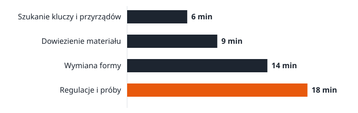

> **Wpis testowy (fikcyjny).** Służy do próby panelu redakcyjnego i nie trafia na produkcję.

Przezbrojenie to czas od ostatniej dobrej sztuki poprzedniego wyrobu do pierwszej dobrej sztuki następnego. Na hali zwykle mówi się o nim jak o koszcie stałym: tyle trwa, bo tak trzeba. Tymczasem duża część tego czasu to czynności, które wcale nie wymagają zatrzymanej maszyny.

Metoda SMED (Single-Minute Exchange of Die), opisana przez Shigeo Shingo [1], porządkuje przezbrojenie w czterech krokach. Nie wymaga nowych maszyn ani systemu informatycznego.

Ten tekst prowadzi przez wszystkie kroki na przykładzie jednego stanowiska.

## Krok 1: nagraj i rozpisz przezbrojenie

Nagraj całe przezbrojenie telefonem, od ostatniej dobrej sztuki do pierwszej dobrej. Potem z zespołem rozpisz każdą czynność z czasem trwania.

## Krok 2: oddziel czynności wewnętrzne od zewnętrznych

Wewnętrzne wymagają zatrzymanej maszyny, zewnętrzne można wykonać w trakcie pracy. Przykład na danych fikcyjnych:

| Czynność | Czas (min) | Rodzaj |
| --- | --- | --- |
| Szukanie kluczy i przyrządów | 6 | wewnętrzna |
| Dowiezienie materiału | 9 | wewnętrzna |
| Wymiana formy | 14 | wewnętrzna |
| Regulacje i próby | 18 | wewnętrzna |

## Krok 3: przenieś pracę przed zatrzymanie

Wszystko, co da się przygotować wcześniej, przygotuj wcześniej: narzędzia na wózku, materiał przy maszynie.

## Krok 4: skróć to, co zostało

Szybkozłącza zamiast śrub, ograniczniki zamiast regulacji, praca dwóch osób równolegle.
