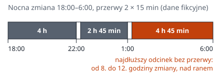

## W skrócie

**Problem.** Dwunastki i serie nocy dają więcej wolnych dni, a badania wiążą je z wyższym ryzykiem wypadku. Na czwartej nocy z rzędu ryzyko jest o około 36% wyższe niż na pierwszej [1, 2].

**Dlaczego.** Według przeglądów badań ryzyko wypadku jest wyższe w nocy, rośnie z kolejnymi nocami w serii, z długością zmiany i z czasem od ostatniej przerwy [1, 2]. Nowsze przeglądy potwierdzają wyższe ryzyko w nocy i przy zmianach dłuższych niż 12 godzin, ale pewność dowodów oceniają jako niską [3, 4].

**Co zrobić.** Zanim podpiszesz grafik na następny miesiąc, sprawdź w nim pięć rzeczy: liczbę nocy z rzędu, długość zmian nocnych, rozłożenie przerw, odpoczynek między zmianami i nadgodziny dokładane do długich zmian.

## Grafik, o który poprosiła załoga

Załoga sama poprosiła o dwunastki i serie czterech nocy, bo dają więcej wolnych dni i mniej dojazdów. Badania wiążą właśnie te cechy grafiku z wyższym ryzykiem wypadku. Taki grafik ma zakład przetwórstwa tworzyw z naszego przykładu (dane fikcyjne), który od roku pracuje w systemie równoważnym. Grafik mieści się w limicie: Kodeks pracy pozwala w tym systemie wydłużyć dobowy wymiar czasu pracy do 12 godzin, jeśli uzasadnia to rodzaj lub organizacja pracy [5]. Dłuższe dni równoważy się krótszymi albo dniami wolnymi [5]. Nikt w zakładzie nie policzył jednak, co taki grafik robi z ryzykiem wypadku.

Przegląd badań z 2005 r. (Folkard, Lombardi, Tucker) zestawia wyniki wcześniejszych prac. W systemach zmian 8-godzinnych ryzyko wypadku było na zmianie popołudniowej o 18% wyższe niż na rannej, a na nocnej o 30% [1]. Na czwartej nocy z rzędu było o 36% wyższe niż na pierwszej [1]. Dla zmian 12-godzinnych autorzy oszacowali na podstawie czterech badań ryzyko o 27% wyższe niż dla 8-godzinnych [1].

Grafik jest więc także oceną ryzyka. Trzy liczby, od których ono zależy, policzysz w nim, zanim trafi na tablicę ogłoszeń: kolejne noce, godziny na zmianie i odstępy między przerwami.

## Ryzyko zależy od nocy, godzin i przerw

Badania podają ryzyko względne: wynik 1,36 znaczy, że na tę samą liczbę przepracowanych godzin wypada o 36% więcej wypadków niż na zmianie, z którą porównujesz [2]. Część badań liczy tylko urazy, część także zdarzenia bez urazu, więc „ryzyko wypadku” obejmuje w tym tekście jedne i drugie [2, 3, 4].

### Każda kolejna noc dokłada więcej niż kolejny dzień

Ryzyko rośnie z każdą kolejną nocą w serii, i to szybciej niż przy kolejnych zmianach rannych i dziennych [1, 2]. Metaanaliza z 2017 r. potwierdza też różnicę między porami: na podstawie 14 badań zmiana nocna ma ryzyko o 36% wyższe niż ranna [2]. Według autorów metaanalizy z 2021 r. wcześniejsze przeglądy opierały się jednak w dużej części na tych samych badaniach [3].

, zestawienie 7 badań (noce) i 5 badań (zmiany ranne lub dzienne).")

### Długie zmiany wiążą się z wyższym ryzykiem, ale dowody są słabsze

W zestawieniu czterech badań długość zmiany od około 4 do 9 godzin prawie nie zmieniała ryzyka, ale zmiany 10-godzinne miały je o 13% wyższe niż 8-godzinne [1]. Według metaanalizy z 2017 r. ryzyko wyraźnie rośnie po dziewiątej godzinie pracy [2], ale nowsza metaanaliza tego nie potwierdziła [3].

### Im dłużej od przerwy, tym wyższe ryzyko

Jedno z badań objęło zakład inżynieryjny z przerwami co 2 godziny. Ryzyko rosło tam między przerwami mniej więcej liniowo, a w ostatnich 30 minutach przed przerwą było dwa razy wyższe niż w pierwszych 30 minutach po niej [1]. Metaanaliza pokazuje, że każda kolejna półgodzina pracy bez przerwy podnosi ryzyko, a przerwa 31–60 minut mocno je obniża [2].

## Sprawdź grafik w pięciu pytaniach

### 1. Ile nocy z rzędu?

Policz najdłuższą serię nocy w grafiku każdej osoby, a nie brygady. Zamiany i zastępstwa wydłużają serie poza to, co widać w planie. Przy czterech nocach z rzędu ostatnia ma według przeglądu ryzyko o 36% wyższe niż pierwsza, przy trzech o 17% [1]. Jeśli załoga chce serii nocy, sprawdź, czy da się je skrócić do trzech i dołożyć noce w kolejnym cyklu.

### 2. Ile godzin trwa zmiana nocna i kto na niej pracuje?

Kodeks pracy ogranicza do 8 godzin na dobę pracę osoby pracującej w nocy, jeżeli wykonuje ona prace szczególnie niebezpieczne albo związane z dużym wysiłkiem fizycznym lub umysłowym [5]. Pora nocna to 8 godzin między 21:00 a 7:00 [5]. Pracującym w nocy jest ten, kto ma w niej w każdej dobie co najmniej 3 godziny pracy albo jedną czwartą czasu pracy w okresie rozliczeniowym [5].

Wykaz takich prac ustala pracodawca w porozumieniu z zakładową organizacją związkową, a gdy jej nie ma, z przedstawicielami pracowników, po zasięgnięciu opinii lekarza sprawującego opiekę profilaktyczną [5]. Zapytaj kadry i służbę BHP, czy wykaz istnieje i czy grafik nocnych dwunastek go uwzględnia. Przepis ma wyjątki, więc wątpliwe przypadki rozstrzygnie prawnik.

### 3. Co ile godzin jest przerwa?

Kodeks pracy daje co najmniej 15 minut przerwy przy dobowym wymiarze czasu pracy od 6 godzin, a przy wymiarze dłuższym niż 9 godzin kolejne co najmniej 15 minut [5]. Przy zmianie 12-godzinnej to minimum dwie krótkie przerwy. Skoro ryzyko rośnie z czasem od ostatniej przerwy, liczy się nie tylko ich długość, ale i rozłożenie [1, 2]. Sprawdź, ile godzin dzieli koniec ostatniej przerwy od końca zmiany: na zmianie nocnej to właśnie godziny nad ranem.

### 4. Ile godzin odpoczynku między zmianami?

Pracownikowi przysługuje co najmniej 11 godzin nieprzerwanego odpoczynku w każdej dobie, z wyjątkami opisanymi w Kodeksie [5]. W przeglądzie z 2025 r. jedno badanie powiązało z wyższym ryzykiem zdarzeń krótszy odpoczynek między zmianami, a drugie dłuższe zmiany [4]. Sprawdź też zamiany zmian: krótki odpoczynek łatwo powstaje wtedy, gdy ktoś bierze zmianę za kolegę.

### 5. Ile nadgodzin dokładasz do długich zmian?

Nadgodziny ze względu na szczególne potrzeby pracodawcy nie mogą przekroczyć 150 godzin w roku kalendarzowym na pracownika [5]. Inną liczbę może ustalić układ zbiorowy, regulamin pracy albo umowa o pracę [5]. Nadgodzina dołożona do dwunastki to jednak trzynasta godzina pracy, a według metaanalizy z 2017 r. ryzyko rośnie wyraźnie już od dziewiątej [2].

Pięć pytań mieści się na jednej kartce.

| Pytanie | Co policzyć | Co mówią dane i przepisy |
|---|---|---|
| Ile nocy z rzędu? | najdłuższą serię nocy u każdej osoby | 4. noc: ryzyko o 36% wyższe niż na 1. [1] |
| Ile trwa zmiana nocna? | godziny zmiany i prace z wykazu | 12 h: szacunek +27% wobec 8 h [1]; najwyżej 8 h dla pracującego w nocy przy pracach szczególnie niebezpiecznych [5] |
| Co ile przerwa? | najdłuższy odcinek pracy bez przerwy | ryzyko rośnie z każdą półgodziną bez przerwy [2]; minimum 2 × 15 min przy wymiarze ponad 9 h [5] |
| Ile odpoczynku? | najkrótszy odpoczynek, także po zamianach | co najmniej 11 h w każdej dobie [5] |
| Ile nadgodzin? | godziny dokładane po dwunastce | 150 h w roku przy szczególnych potrzebach pracodawcy [5] |

### W grafiku z przykładu większość odpowiedzi wypada źle

W zakładzie z początku tekstu zmiana nocna trwa od 18:00 do 6:00, przerwy wypadają o 22:00 i o 1:00, a na zmianie pracują operatorzy pras. Tak wypadają odpowiedzi na pięć pytań i tak może wyglądać poprawiony grafik (dane fikcyjne):

| Pytanie | Grafik z przykładu | Po zmianie |
|---|---|---|
| Ile nocy z rzędu? | 4, a ryzyko jest najwyższe po więcej niż trzech [2] | 3, brakujące noce w kolejnym tygodniu |
| Ile trwa zmiana nocna? | 12 h, wykaz prac szczególnie niebezpiecznych niesprawdzony | 12 h po sprawdzeniu wykazu; przy pracach z wykazu najwyżej 8 h [5] |
| Co ile przerwa? | 22:00 i 1:00 po 15 min, potem prawie 5 h pracy do 6:00 | 21:00, 0:00 i 3:00 po 15 min, najwyżej 3 h pracy bez przerwy |
| Ile odpoczynku? | 12 h między nocami, 10 h po nadgodzinach | 12 h |
| Ile nadgodzin? | do 8:00, gdy ktoś choruje | żadnych po nocy, zastępstwo z rezerwy |

Między kolejnymi nocami operator ma 12 godzin odpoczynku, od 6:00 do 18:00, więc już ponad godzina nadgodzin łamie minimum. Gdy operator choruje, kolega zostaje dwie godziny dłużej, do ósmej rano. Przed kolejną nocą ma wtedy tylko 10 godzin odpoczynku, a Kodeks wymaga co najmniej 11, z wyjątkami takimi jak akcja ratownicza czy usuwanie awarii [5].

## Własny rejestr pokaże, gdzie skupiają się zdarzenia

W 2024 r. GUS odnotował 67 000 osób poszkodowanych w zgłoszonych wypadkach przy pracy, nie licząc indywidualnych gospodarstw rolnych [6]. Nie publikuje ich jednak według godziny zmiany ani numeru nocy w serii [6]. Te dane zbierzesz tylko we własnym zakładzie. Do każdego wypadku i zdarzenia potencjalnie wypadkowego dopisz trzy liczby: godzinę od początku zmiany, numer nocy albo dnia w serii i minuty od ostatniej przerwy.

| Data | Stanowisko | Godzina od początku zmiany | Noc lub dzień w serii | Minuty od ostatniej przerwy | Rodzaj zdarzenia |
|---|---|---|---|---|---|
| 12.11 | prasa 3 | 11. | 4. noc | 200 | zdarzenie bez urazu (wpis przykładowy) |

Przy kilku wypadkach rocznie własne dane nic nie udowodnią. Pokażą jednak, czy zdarzenia skupiają się pod koniec długich zmian albo na ostatnich nocach. Zbieraj też zdarzenia bez urazu: jest ich więcej, więc wzór pojawi się szybciej. Po roku porównaj je z grafikiem. Jeśli zdarzenia skupiają się w ostatnich godzinach długich zmian albo na ostatnich nocach serii, masz argument za zmianą grafiku. Jeśli rozkładają się równo, szukaj przyczyn gdzie indziej: w maszynach, w szkoleniu, w organizacji pracy.

## Dwunastki mogą zostać, ale nie bez zmian

Jeśli zmian 12-godzinnych nie da się zmienić, zostaje kilka ruchów w ich obrębie. Każdy wynika z tych samych trzech dźwigni.

Skróć serie nocy. Pierwsze noce w serii są bezpieczniejsze niż ostatnia, więc średnio cała seria czterech nocy wypada o około 15% gorzej niż pierwsza noc [1]. Seria trzech nocy wypada średnio o około 8% gorzej (obie średnie to obliczenia redakcji) [1]. Skrócenie serii z czterech do trzech nocy zmniejsza więc nadwyżkę ryzyka na nocnych zmianach mniej więcej o połowę.

Nowsze badania są tu niejednoznaczne: w dwóch z nich przy większej liczbie nocy ryzyko z czasem malało [4]. Jeśli po skróceniu serii brakuje nocy w cyklu, dołóż je w kolejnym tygodniu. Krótsze serie oznaczają jednak częstsze przejścia między dniem a nocą, więc taką zmianę omów z załogą i obserwuj rejestr zdarzeń.

Dodaj przerwę ponad minimum z Kodeksu i rozłóż przerwy równo. Według metaanalizy z 2017 r. ryzyko jest najwyższe, gdy przerwy wypadają rzadziej niż co 4 godziny albo trwają krócej niż 30 minut [2]. Tak samo jest przy zmianach dłuższych niż 11 godzin i przy pracy w nocy, zwłaszcza po więcej niż trzech nocach z rzędu [2]. Grafik z przykładu spełnia wszystkie te warunki. Trzy 15-minutowe przerwy o 21:00, 0:00 i 3:00 dzielą zmianę na odcinki najwyżej trzygodzinne, a trzecia przerwa kosztuje około 2% czasu zmiany. To niewiele.

Według metaanalizy z 2017 r. ryzyko wyraźnie rośnie po dziewiątej godzinie pracy [2]. Prace, przy których pomyłka kosztuje najwięcej, na przykład przezbrojenia, czyszczenie maszyn czy prace na wysokości, planuj więc na początek zmiany. Nie dokładaj nadgodzin do dwunastek. Nie układaj też grafiku tak, żeby po ostatniej nocy ta sama osoba wracała już następnego dnia na zmianę dzienną. Kodeks wymaga tylko 11 godzin odpoczynku w każdej dobie [5], więc taki skok trzeba wykluczyć w grafiku.

## Kierunek jest spójny, wielkości niepewne

Nowsze przeglądy potwierdzają kierunek, ale pewność dowodów oceniają jako niską [3, 4]. Metaanaliza z 2021 r. wykazała dla zmian dłuższych niż 12 godzin ryzyko o 24% wyższe niż przy pracy do 8 godzin, ale tylko w trzech badaniach [3]. Wszystkie osiem badań razem nie dało istotnej różnicy [3]. W wielu badaniach praca nocna miesza się z długością zmian, więc trudno rozdzielić te dwa czynniki [3]. Liczby z przeglądu z 2005 r. nie mają przedziałów ufności [1]. Dlatego służą do porównywania grafików, a nie do obiecywania, o ile mniej będzie wypadków.

Większość badań nie pochodzi z przemysłu: w przeglądzie z 2025 r. 11 z 24 badań dotyczyło ochrony zdrowia, a tylko 3 przemysłu [4]. Zakład z lekką pracą przy maszynach automatycznych może mieć inny profil ryzyka niż ten, w którym ludzie obsługują prasy i wózki.

## Cztery noce na tablicy ogłoszeń

Zakład przetwórstwa tworzyw może zostać przy dwunastkach, o które prosiła załoga. Grafik to jednak umowa z ludźmi, więc pokaż im te liczby, zanim go zmienisz.

Pierwszy krok zajmie godzinę: wydrukuj grafik na następny miesiąc i dla każdej osoby zapisz najdłuższą serię nocy, najdłuższą zmianę i najkrótszy odpoczynek. Jeśli ktoś ma więcej niż trzy noce z rzędu albo mniej niż 11 godzin odpoczynku, popraw grafik, zanim trafi na tablicę.
